# Архитектура проекта

```mermaid
classDiagram
    direction TB

    class name_id {
        <<abstract>>
        -str __id
        -str __name
        +id : str
        +name : str
        +__eq__(other) bool
    }

    class range_model {
        -float __conversion_factor
        -range_model __base_range
        +conversion_factor float
        +base_range range_model
    }

    class nomenclature_group_model {
    }

    class storage_model {
        -str __address
        +address str
    }

    class organization_model {
        -str __inn
        -str __bik
        -str __account
        -str __ownership_form
        +inn str
        +bik str
        +account str
        +ownership_form str
    }

    class nomenclature_model {
        -str __full_name
        -nomenclature_group_model __group
        -range_model __range
        +full_name str
        +group nomenclature_group_model
        +range range_model
    }

    class settings_model {
        -organization_model __organization
        -str __boss_name
        -str __account_name
        -bool __is_first_start
        -report_type_enum __response_format
        +organization organization_model
        +company organization_model
        +boss_name str
        +account_name str
        +is_first_start bool
        +response_format report_type_enum
        +from_dto(dto, resolver) settings_model$
    }

    class abstract_dto {
        <<abstract>>
        +load_dict(data: dict) abstract_dto
    }

    class settings_dto {
        -str __boss_name
        -str __account_name
        -bool __is_first_start
        -str __response_format
        -company_dto __organization
        +boss_name str
        +account_name str
        +is_first_start bool
        +response_format str
        +organization company_dto
    }

    class company_dto {
        +name str
        +inn str
        +bik str
        +account str
        +ownership_form str
    }

    class response_format_dto {
        <<enumeration>>
        +CSV : int
        +MARKDOWN : int
        +JSON : int
        +XML : int
        +TXT : int
        +HTML : int
        +RTF : int
        +YAML : int
    }

    class abstract_manager {
        <<abstract>>
        -str __file_name
        -bool __is_loaded
        -list __data
        +load(file_name: str) None
        +convert() bool
        +is_loaded: bool
    }

    class settings_manager {
        <<Singleton>>
        -str __default_file_name
        -settings_model _settings
        -bool __is_loaded
        -dict __data
        +__new__(cls) settings_manager
        +load(file_name: str) None
        +build() bool
        +convert() bool
        +is_loaded: bool
        +settings: settings_model
    }

    class storage_manager {
        <<Singleton>>
        -dict _storages
        -dict _ranges
        -dict _nomenclatures
        -dict _groups
        -dict _recipes
        -dict _transactions
        -bool __is_initialized
        +__new__(cls) storage_manager
        +first_start() void
        +clear() void
        +convert(settings: settings_model = None) bool
        +resolve_category(entity_type: str) str
        +get_catalog(entity_type: str) dict
        +get_by_type_and_id(entity_type: str, identifier: str) object
        +save_entity(entity) bool
        +delete_entity(entity_type: str, unique_code: str) bool
        +add_storage(item) bool
        +add_range(item) bool
        +add_nomenclature(item) bool
        +add_group(item) bool
        +add_recipe(item) bool
        +add_transaction(item) bool
        +storages: dict
        +ranges: dict
        +nomenclatures: dict
        +groups: dict
        +recipes: dict
        +transactions: dict
        +data: dict
        +is_initialized: bool
        +is_loaded: bool
    }

    class entity_service {
        -storage_manager __storage
        +storage: storage_manager
        +get_catalog(entity_type: str) dict
        +find_referrers(unique_code: str) list
        +is_linked(unique_code: str) bool
        +validate_dependencies_exist(dto, entity) tuple
        +get_entity(entity_type: str, unique_code: str) object
        +create_entity(entity_type: str, payload: dict, worker) object
        +update_entity(entity_type: str, unique_code: str, payload: dict) object
        +delete_entity(entity_type: str, unique_code: str) bool
    }

    class recipe_row_model {
        -nomenclature_model __nomenclature
        -range_model __range
        -recipe_model __sub_recipe
        -float __brutto
        -float __netto
        +nomenclature: nomenclature_model
        +range: range_model
        +sub_recipe: recipe_model
        +brutto: float
        +netto: float
        +create_ingredient(nomenclature, brutto, netto) recipe_row_model
        +create_sub_recipe(nomenclature, sub_recipe, netto) recipe_row_model
    }

    class recipe_model {
        -nomenclature_model __dish
        -list __rows
        -int __cooking_time
        -list __instructions
        -int __portions
        +dish: nomenclature_model
        +rows: list
        +cooking_time: int
        +instructions: list
        +portions: int
        +brutto: float
        +netto: float
        +add_row(row) bool
        +remove_row(row_or_id) bool
        +clear_rows() void
        +create_pancake_dough_recipe() recipe_model
        +create_pancakes_recipe() recipe_model
        +create_primary_list(nomenclatures) list
    }

    class abstract_convertor {
        <<abstract>>
        +convert(field: str, obj: Any) dict*
    }

    class basic_convertor {
        +convert(field: str, obj: Any) dict
    }

    class datetime_convertor {
        +convert(field: str, obj: Any) dict
    }

    class reference_convertor {
        +convert(field: str, obj: Any) dict
    }

    class convert_factory {
        -dict _convertors
        +register(target_type, convertor_cls)
        +get_convertor(obj_or_type) abstract_convertor
        +convert(field: str, obj: Any) dict
        +serialize(obj: Any) Any
        +to_json(obj: Any, indent: int) str
    }

    class abstract_prototype {
        <<abstract>>
        +clone(filter) abstract_prototype*
    }

    class prototype {
        -list _data
        +data: list
        +clone(filter_model: filter_dto) prototype
        +create_osv() prototype
    }

    class filter_type_enum {
        <<enumeration>>
        +EQUALS: str
        +LIKE: str
    }

    class filter_item_dto {
        -str _field_name
        -filter_type_enum _filter_type
        -Any _value
        +is_match(val) bool
    }

    class filter_dto {
        -str _name
        -str _unique_code
        -filter_type_enum _filter_type
        -list _filters
        +all_filters: list
    }

    class transaction_model {
        -storage_model __storage
        -nomenclature_model __nomenclature
        -range_model __range
        -float __value
        -datetime __period
        +value: float
        +storage: storage_model
        +nomenclature: nomenclature_model
        +range: range_model
        +period: datetime
        +references() list
    }

    class osv_row_model {
        +storage: storage_model
        +nomenclature: nomenclature_model
        +range: range_model
        +start_balance: float
        +incoming: float
        +outgoing: float
        +final_balance: float
        +references() list
    }

    name_id <|-- range_model
    name_id <|-- nomenclature_group_model
    name_id <|-- storage_model
    name_id <|-- organization_model
    name_id <|-- nomenclature_model
    name_id <|-- settings_model
    name_id <|-- recipe_row_model
    name_id <|-- recipe_model
    name_id <|-- transaction_model
    name_id <|-- osv_row_model

    abstract_prototype <|-- prototype
    prototype ..> filter_dto : clone
    prototype ..> osv_row_model : create_osv
    filter_dto *-- filter_item_dto : filters
    filter_dto o-- filter_type_enum : filter_type
    filter_item_dto o-- filter_type_enum : filter_type

    abstract_manager <|-- settings_manager
    abstract_manager <|-- storage_manager

    abstract_dto <|-- settings_dto
    abstract_dto <|-- company_dto

    entity_service o-- storage_manager : __storage

    abstract_convertor <|-- basic_convertor
    abstract_convertor <|-- datetime_convertor
    abstract_convertor <|-- reference_convertor
    convert_factory ..> abstract_convertor : creates
    reference_convertor ..> convert_factory : delegates

    nomenclature_model o-- nomenclature_group_model : group
    nomenclature_model o-- range_model : range
    range_model o-- range_model : base_range

    settings_manager o-- settings_model : _settings
    settings_model o-- organization_model : __organization
    settings_dto o-- company_dto : __organization
    settings_manager ..> settings_dto : uses for deserialization
    settings_model ..> settings_dto : from_dto()

    storage_manager o-- storage_model : _storages
    storage_manager o-- range_model : _ranges
    storage_manager o-- nomenclature_group_model : _groups
    storage_manager o-- nomenclature_model : _nomenclatures
    storage_manager o-- recipe_model : _recipes
    storage_manager o-- transaction_model : _transactions

    transaction_model o-- storage_model : storage
    transaction_model o-- nomenclature_model : nomenclature
    transaction_model o-- range_model : range

    osv_row_model o-- storage_model : storage
    osv_row_model o-- nomenclature_model : nomenclature
    osv_row_model o-- range_model : range

    recipe_model *-- recipe_row_model : rows
    recipe_model o-- nomenclature_model : dish
    recipe_row_model o-- nomenclature_model : nomenclature
    recipe_row_model o-- range_model : range
    recipe_row_model o-- recipe_model : sub_recipe
    storage_manager ..> settings_manager : uses
    settings_model o-- response_format_dto : __response_format
```

---

## Архитектура подсистем
* [Связи доменных моделей и рекурсия (EntityTree)](./EntityTree.md)
* [Диаграммы последовательности (SequenceDiagrams)](./SequenceDiagrams.md)
* [Паттерн Прототип, фильтрация данных и ОСВ (Prototype)](./Prototype.md)
* [Варианты использования (UseCase)](./UseCase.md)
* [Архитектура подсистемы сериализации в JSON (JsonSerialization)](./JsonSerialization.md)
* [Архитектура подсистемы отчетов (Abstract Factory & Template Method)](./ReportFactory.md)
* [Архитектура модели рецептов (RecipeModel)](./RecipeModel.md)
* [Архитектура менеджера настроек (SettingsManager)](./SettingsManager.md)
* [Архитектура складского учета и сервиса сущностей (StorageManager)](./StorageManager.md)
