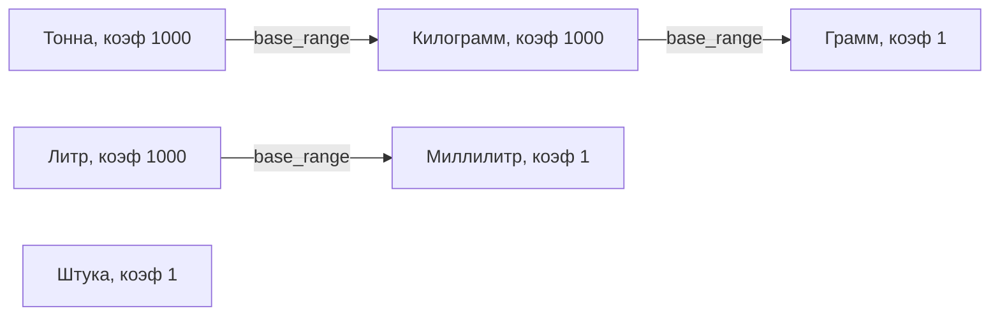
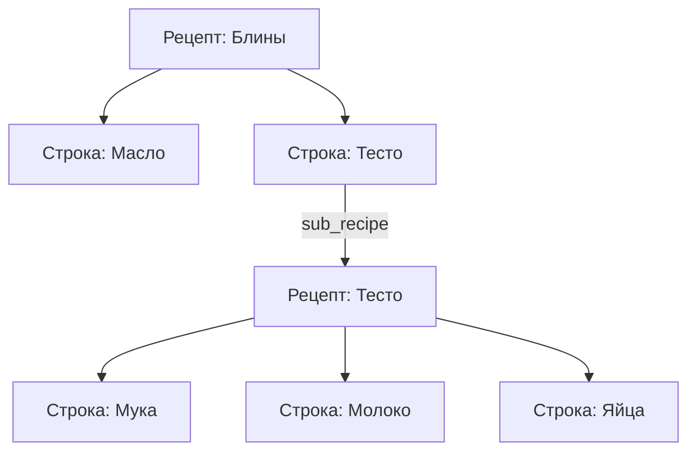
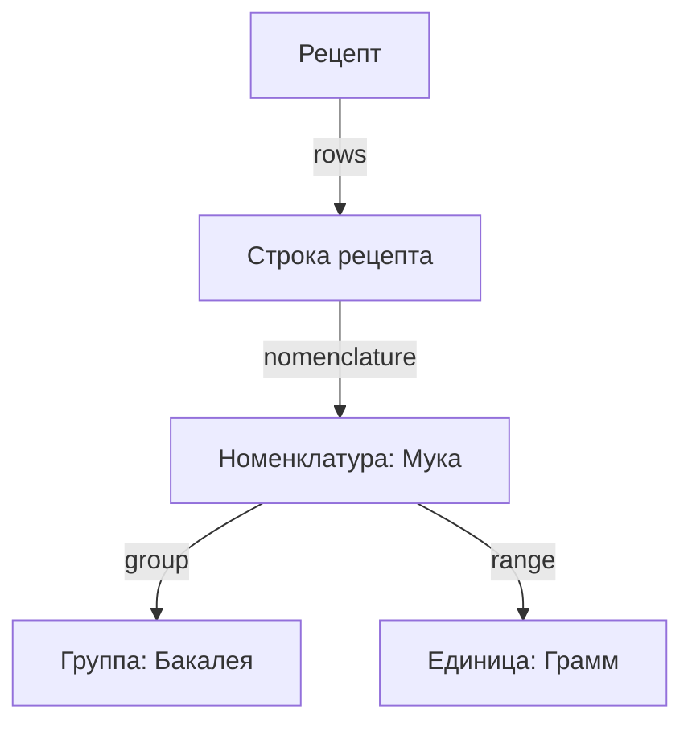

# Структура связей моделей (EntityTree)

## 1. Связи единиц измерения (range_model)

Единицы измерения ссылаются друг на друга по цепочке через поле `base_range` (от большей к меньшей базовой):



В JSON это раскрывается во вложенные объекты:
```json
{
  "name": "Тонна",
  "conversion_factor": 1000,
  "base_range": {
    "name": "Килограмм",
    "conversion_factor": 1000,
    "base_range": {
      "name": "Грамм",
      "conversion_factor": 1,
      "base_range": null
    }
  }
}
```

---

## 2. Составные рецепты (recipe_model)

В рецепте есть список строк `rows`. Строка может содержать обычный ингредиент, либо полуфабрикат — то есть другой рецепт (`sub_recipe`):



При расчете веса (брутто/нетто) или сериализации в JSON система рекурсивно обходит состав вложенного рецепта.

---

## 3. Общие связи моделей в хранилище

В `storage_manager` лежат списки объектов, которые ссылаются друг на друга:



Конвертер `reference_convertor` находит эти ссылки через свойства (`@property`) и передает их в фабрику для формирования словарей.
