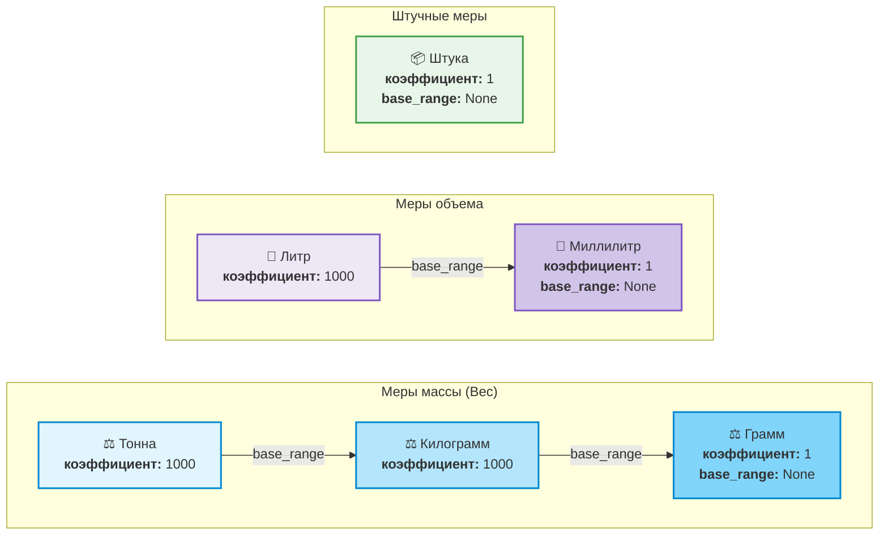
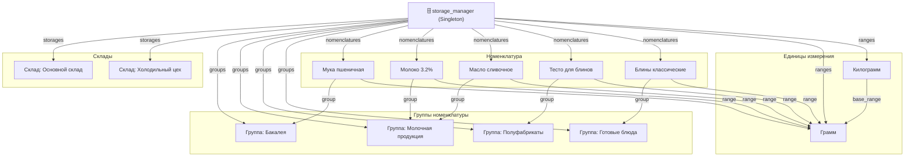

# Граф иерархических и рекурсивных связей доменных объектов (Object & Dependency Tree)

Данный документ визуализирует структуру связанных объектов предметной области в оперативной памяти (`storage_manager`), создаваемых при первом старте приложения (`first_start()`). 

Схема раскрывает ключевые архитектурные принципы и **рекурсивную природу доменных моделей**:
1. Рекурсия цепочки единиц измерения через свойство `base_range`.
2. Рекурсия технологических карт через включение полуфабрикатов `sub_recipe`.

---

## 1. Рекурсивная иерархия единиц измерения (`range_model`)

В единицах измерения производные единицы ссылаются на базовые через свойство `base_range`, образуя цепочку пересчета коэффициентов:



*При сериализации в JSON:* фабрика `convert_factory` рекурсивно разворачивает `Тонна` $\rightarrow$ `Килограмм` $\rightarrow$ `Грамм` во вложенные словари:
```json
{
  "name": "тонна",
  "conversion_factor": 1000,
  "base_range": {
    "name": "килограмм",
    "conversion_factor": 1000,
    "base_range": {
      "name": "грамм",
      "conversion_factor": 1,
      "base_range": null
    }
  }
}
```

---

## 2. Иерархия технологической карты с полуфабрикатом (`recipe_model`)

Блюдо «Блины классические» содержит как простые ингредиенты (сливочное масло), так и полуфабрикат «Тесто для блинов», который сам является технологической картой со своим набором ингредиентов:

```mermaid
graph TD
    %% Готовое блюдо
    subgraph DishLevel ["1. Верхний уровень: Готовое блюдо"]
        Recipe_Pancakes["🥞 <b>Рецепт: Блины классические</b><br/>Порций: 1 | Время: 25 мин<br/><b>Нетто:</b> 187.5 г | <b>Брутто:</b> 221.25 г"]
        Row_Butter["Строка 1: Ингредиент<br/>Масло сливочное<br/>брутто: 12.5г | нетто: 12.5г"]
        Row_Dough["Строка 2: Полуфабрикат<br/>Тесто для блинов<br/>нетто: 175.0г | брутто: рекурсивно"]
    end

    Recipe_Pancakes -->|rows| Row_Butter
    Recipe_Pancakes -->|rows| Row_Dough

    %% Полуфабрикат (Вложенный рецепт)
    subgraph SubRecipeLevel ["2. Вложенный уровень: Полуфабрикат (sub_recipe)"]
        Recipe_Dough["🥣 <b>Рецепт (Полуфабрикат): Тесто для блинов</b><br/>Порций: 1 | Время: 15 мин<br/><b>Нетто:</b> 205.75 г | <b>Брутто:</b> 208.75 г"]
        
        SR_Flour["Строка 2.1: Мука пшеничная<br/>брутто: 50.0г | нетто: 50.0г"]
        SR_Milk["Строка 2.2: Молоко 3.2%<br/>брутто: 125.0г | нетто: 125.0г"]
        SR_Egg["Строка 2.3: Яйца куриные<br/>брутто: 25.0г | нетто: 22.0г"]
        SR_Sugar["Строка 2.4: Сахар<br/>брутто: 7.5г | нетто: 7.5г"]
        SR_Salt["Строка 2.5: Соль<br/>брутто: 1.25г | нетто: 1.25г"]
    end

    Row_Dough -->|sub_recipe (РЕКУРСИЯ)| Recipe_Dough
    Recipe_Dough -->|rows| SR_Flour
    Recipe_Dough -->|rows| SR_Milk
    Recipe_Dough -->|rows| SR_Egg
    Recipe_Dough -->|rows| SR_Sugar
    Recipe_Dough -->|rows| SR_Salt

    style Recipe_Pancakes fill:#fff3e0,stroke:#fb8c00,stroke-width:3px
    style Recipe_Dough fill:#f3e5f5,stroke:#8e24aa,stroke-width:2px
    style Row_Dough fill:#fce4ec,stroke:#d81b60,stroke-width:2px
    style Row_Butter fill:#e8f5e9,stroke:#43a047
```

---

## 3. Сквозной граф связей объектов предметной области

Диаграмма показывает, как все доменные модели пересекаются и агрегируются в хранилище `storage_manager`:



---

## 4. Как подсистема сериализации обходит этот граф

1. **Единая точка входа:** метод `convert_factory.serialize(obj)`.
2. **Определение типа через реестр:** для моделей `abstract_model` вызывается `reference_convertor`.
3. **Обход свойств (`@property`):** конвертер через интроспекцию запрашивает значения всех публичных свойств.
4. **Спуск по ссылкам:** встретив вложенную модель (например, `base_range` или `sub_recipe`), конвертер повторно делегирует ее сериализацию фабрике `convert_factory`.
5. **Защита от зацикливания:** реестр `visited_ids` гарантирует, что каждый объект графа сериализуется единожды, исключая переполнение стека (`RecursionError`).
