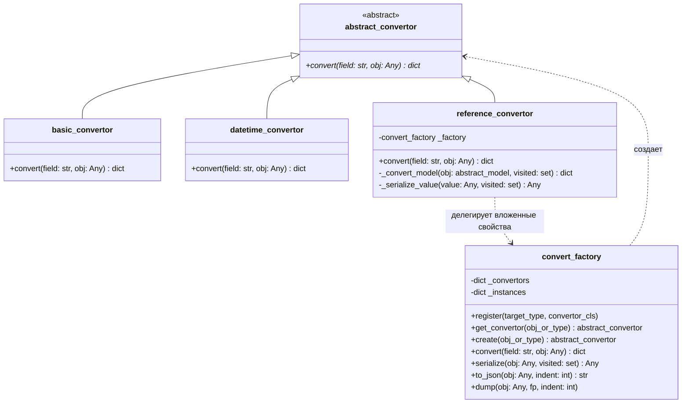

# Сериализация в JSON (JsonSerialization)

## 1. Диаграмма классов



---

## 2. Классы и методы

* **`abstract_convertor`** (`Src/Core/abstract_convertor.py`)
  * Базовый абстрактный класс.
  * Метод: `convert(field: str, obj: Any) -> dict`.

* **`basic_convertor`** (`Src/Logics/basic_convertor.py`)
  * Обрабатываемые типы: `int`, `float`, `str`, `bool`, `None`.
  * Результат: словарь `{field: value}`.
  * Ошибки: `argument_exception` при передаче неподдерживаемого типа.

* **`datetime_convertor`** (`Src/Logics/datetime_convertor.py`)
  * Обрабатываемые типы: `datetime.datetime`, `datetime.date`.
  * Результат: словарь `{field: "YYYY-MM-DDTHH:MM:SS"}` (ISO 8601).

* **`reference_convertor`** (`Src/Logics/reference_convertor.py`)
  * Обрабатываемые типы: наследники `abstract_model`.
  * Читает публичные свойства объекта (`@property`).
  * Для вложенных моделей рекурсивно вызывает `convert_factory.serialize()`.
  * Проверяет множество `visited_ids` для предотвращения циклических ссылок.

* **`convert_factory`** (`Src/Logics/convert_factory.py`)
  * Реестр соответствия типов и классов конвертеров: `dict[type, Type[abstract_convertor]]`.
  * `register(type, convertor_cls)` — регистрация конвертера для типа.
  * `get_convertor(obj_or_type)` — поиск конвертера по типу.
  * `convert(field, obj)` — вызов конвертера для одного поля.
  * `serialize(obj)` — перевод объекта, списка или словаря в структуру из примитивов, `dict` и `list`.
  * `to_json(obj, indent=2)` — сериализация результата `serialize()` в JSON-строку через `json.dumps`.

---

## 3. Примеры вызова

### Одиночная модель
```python
from Src.Logics.convert_factory import convert_factory
from Src.Models.nomenclature_group_model import nomenclature_group_model

factory = convert_factory()
group = nomenclature_group_model("Сырье")

# Словарь
data = factory.convert("group", group)
# {'group': {'id': '...', 'name': 'Сырье'}}

# JSON-строка
json_str = factory.to_json(group)
```

### Вложенные модели (единицы измерения)
```python
from Src.Logics.convert_factory import convert_factory
from Src.Models.range_model import range_model

factory = convert_factory()

gram = range_model("грамм", 1, None)
kg = range_model("кг", 1000, gram)
ton = range_model("тонна", 1000, kg)

print(factory.to_json(ton))
```

Вывод:
```json
{
  "id": "58565694-0a4e-4ecd-8fbd-2ccc0a35044e",
  "name": "тонна",
  "base_range": {
    "id": "be9072c9-923c-4c7d-85dd-550ee2e2e57e",
    "name": "кг",
    "base_range": {
      "id": "e502a791-ebd0-4e8c-a20a-f8cd57cdcdae",
      "name": "грамм",
      "base_range": null,
      "conversion_factor": 1
    },
    "conversion_factor": 1000
  },
  "conversion_factor": 1000
}
```

### Данные хранилища
```python
from Src.Logics.convert_factory import convert_factory
from Src.Logics.storage_manager import storage_manager

sm = storage_manager()
sm.load()

factory = convert_factory()
json_storage = factory.to_json(sm.data)
```
