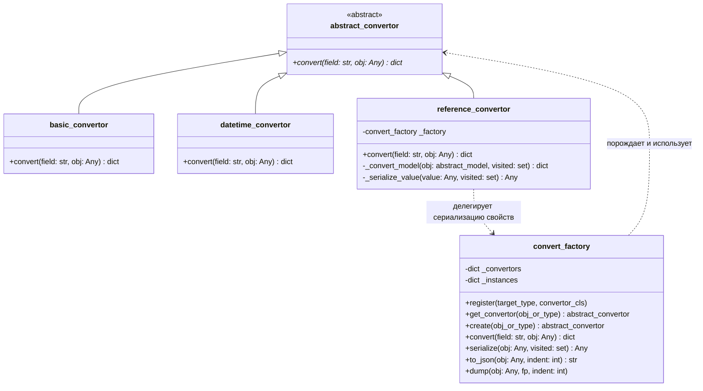
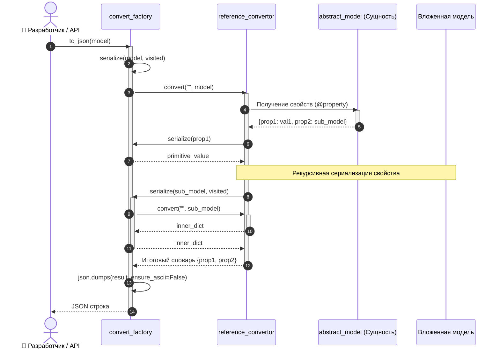

# Архитектура подсистемы сериализации доменных моделей в JSON

Данный документ описывает структуру, примененные паттерны проектирования и примеры использования подсистемы сериализации в формат JSON для лабораторной работы № 6 («Сериализация Json (№ 6)»).

---

## 1. Архитектурная концепция

В соответствии с архитектурными требованиями проекта сериализация реализована без привлечения тяжеловесных сторонних библиотек (таких как Pydantic или Marshmallow). 

### Пайплайн преобразования:
$$\text{Доменная модель / Хранилище} \xrightarrow{\text{Фабрика и Конвертеры}} \text{Вложенные словари Python (dict/list)} \xrightarrow{\text{json.dumps}} \text{Итоговый JSON}$$

Преобразование строится на двух ключевых принципах:
1. **Паттерн «Фабрика» (Factory) с реестром типов (`dict[Type, Convertor]`):** полиморфный выбор соответствующего обработчика без процедурных конструкций `if-elif-else`.
2. **Рекурсивная сериализация:** рекурсивный спуск по графу связанных доменных объектов (например, единицы измерения с `base_range` или технологические карты с вложенными `sub_recipe`).

---

## 2. Диаграмма классов



---

## 3. Описание компонентов

### 3.1 `abstract_convertor` (`Src/Core/abstract_convertor.py`)
- Базовый абстрактный класс (`ABC`).
- Задает метод `convert(self, field: str, obj: Any) -> dict`.
- Экспортирует алиас `abstract_covertor = abstract_convertor` на случай проверки опечатки в тестах проверяющей системы.

### 3.2 `basic_convertor` (`Src/Logics/basic_convertor.py`)
- Обрабатывает примитивные типы: `int`, `float`, `str`, `bool`, `None`.
- При получении неподдерживаемого типа возбуждает исключение `argument_exception`.
- Формирует словарь вида `{field: value}`.

### 3.3 `datetime_convertor` (`Src/Logics/datetime_convertor.py`)
- Обрабатывает объекты `datetime.datetime` и `datetime.date`.
- Преобразует даты в стандартный строковый формат ISO 8601 (`obj.isoformat()`).
- Формирует словарь вида `{field: "2026-10-21T15:30:00"}`.

### 3.4 `reference_convertor` (`Src/Logics/reference_convertor.py`)
- Обрабатывает сущности предметной области, наследующие `abstract_model` (`name_id`).
- Автоматически интроспектирует свойства модели (`@property`), отсеивая приватные поля и псевдонимы (`unique_code`, `base`, `coefficient`, `value`, `items`).
- Делегирует сериализацию вложенных полей фабрике `convert_factory` или выполняет рекурсивный обход.
- Содержит встроенный механизм защиты от бесконечной рекурсии и циклических ссылок (множество `visited_ids`).

### 3.5 `convert_factory` (`Src/Logics/convert_factory.py`)
- Инкапсулирует словарь сопоставления типов `_convertors: dict[type, Type[abstract_convertor]]`.
- Метод `register(type, convertor_cls)` обеспечивает открытость для расширения (Open-Closed Principle).
- Метод `get_convertor(obj_or_type)` полиморфно подбирает конвертер по точному типу либо через `issubclass`.
- Метод `serialize(obj)` преобразует любые структуры (включая коллекции `list`, `dict`, в том числе словарь хранилища `storage_manager.data`).
- Метод `to_json(obj, indent=2)` выполняет финальную сериализацию в JSON через стандартный модуль `json`.

---

## 4. Диаграмма последовательности (UML Sequence Diagram)

Диаграмма иллюстрирует рекурсивный вызов конвертеров и защиту от зацикливания при сериализации связанных моделей:



> Детальные сценарии с кодами ответов HTTP (200, 400, 404) см. в [Диаграммах последовательности (SequenceDiagrams.md)](./SequenceDiagrams.md).

---

## 5. Примеры использования

### Сериализация отдельной сущности
```python
from Src.Logics.convert_factory import convert_factory
from Src.Models.nomenclature_group_model import nomenclature_group_model

factory = convert_factory()
group = nomenclature_group_model("Сырье")

# Преобразование в словарь
result_dict = factory.convert("group", group)
# {'group': {'id': '...', 'name': 'Сырье'}}

# Преобразование в JSON-строку
json_str = factory.to_json(group)
```

### Рекурсивная цепочка единиц измерения
```python
from Src.Logics.convert_factory import convert_factory
from Src.Models.range_model import range_model

factory = convert_factory()

gram = range_model("грамм", 1, None)
kg = range_model("кг", 1000, gram)
ton = range_model("тонна", 1000, kg)

print(factory.to_json(ton))
```
**Результат:**
```json
{
  "id": "58565694-0a4e-4ecd-8fbd-2ccc0a35044e",
  "name": "тонна",
  "base_range": {
    "id": "be9072c9-923c-4c7d-85dd-550ee2e2e57e",
    "name": "кг",
    "base_range": {
      "id": "e502a791-ebd0-4e8c-a20a-f8cd57cdcdae",
      "name": "грамм",
      "base_range": null,
      "conversion_factor": 1
    },
    "conversion_factor": 1000
  },
  "conversion_factor": 1000
}
```

### Полная выгрузка хранилища `storage_manager`
```python
from Src.Logics.convert_factory import convert_factory
from Src.Logics.storage_manager import storage_manager

sm = storage_manager()
sm.load()

factory = convert_factory()
json_storage = factory.to_json(sm.data)

# Сохранение в файл
with open("storage_dump.json", "w", encoding="utf-8") as f:
    f.write(json_storage)
```
