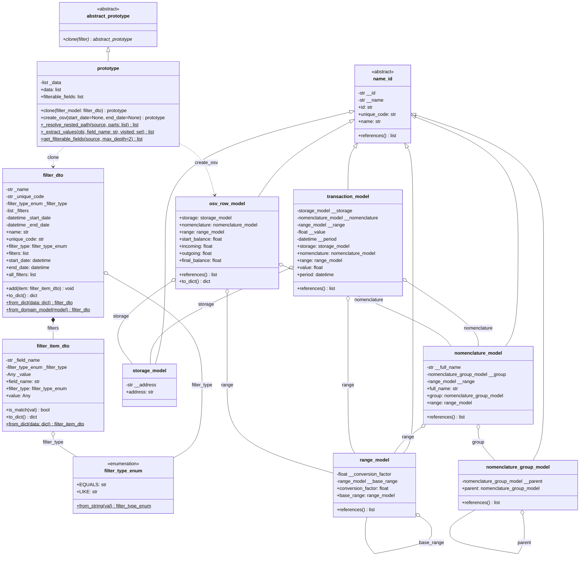
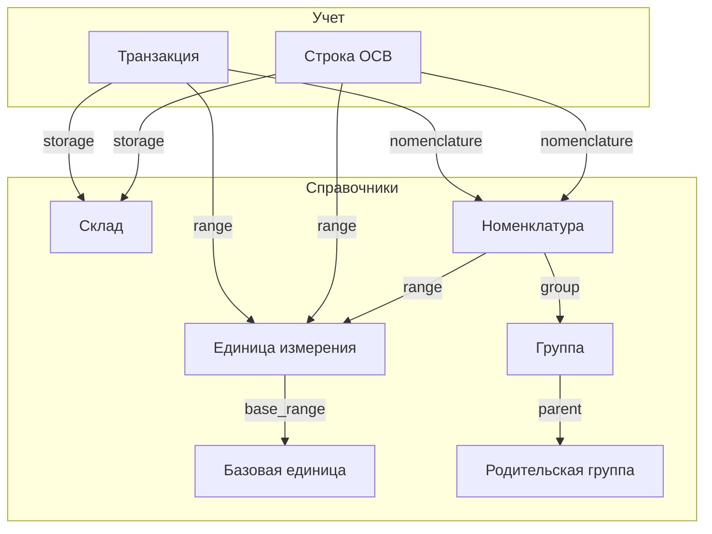
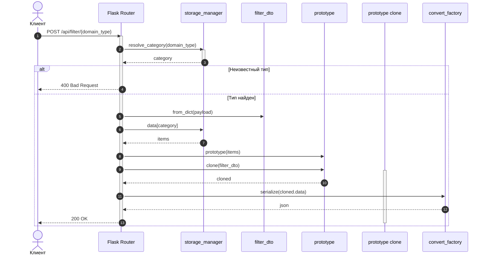
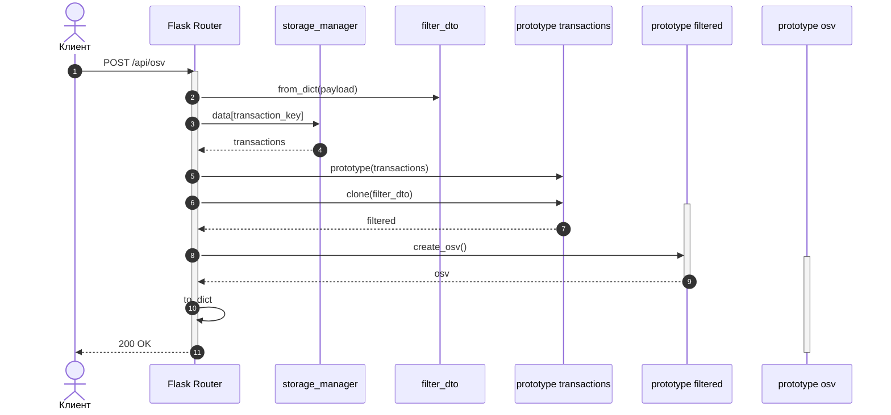

# Прототип и ОСВ

## 1. Диаграмма классов

---

## 2. Связи сущностей

---

## 3. Диаграммы вызовов

### Фильтрация сущностей (POST /api/filter/{domain_type})

### Формирование ОСВ (POST /api/osv)

---

## 4. Как работает фильтрация и почему поля не захардкожены

1. **Нет жестких списков полей в коде:**
   - DTO фильтрации один для всех сущностей. В нем нет списков разрешенных полей.
   - Если передать поле через точку (например, `base_range.name` или `rows.nomenclature.name`), метод `_resolve_nested_path` сам достает значение из вложенных объектов или списков. Если в модели переименуют свойство, фильтрация не сломается.
   - Если передать просто `name`, то значение проверяется как в самом объекте, так и во всех связанных объектах через `references()`.

2. **Работа с любыми полями и числами:**
   - Можно фильтровать по любым полям модели, включая `value` (коэффициент пересчета), `conversion_factor` и т.д.
   - В `is_match` поддержано сравнение чисел: если пришло число или строка с числом, они сравниваются как числа.

