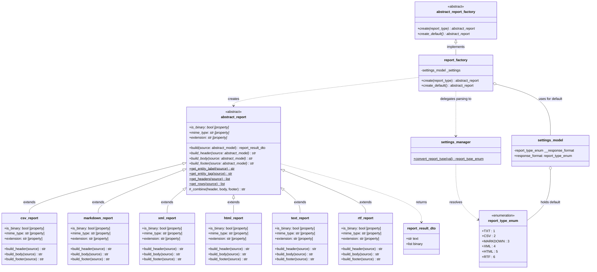
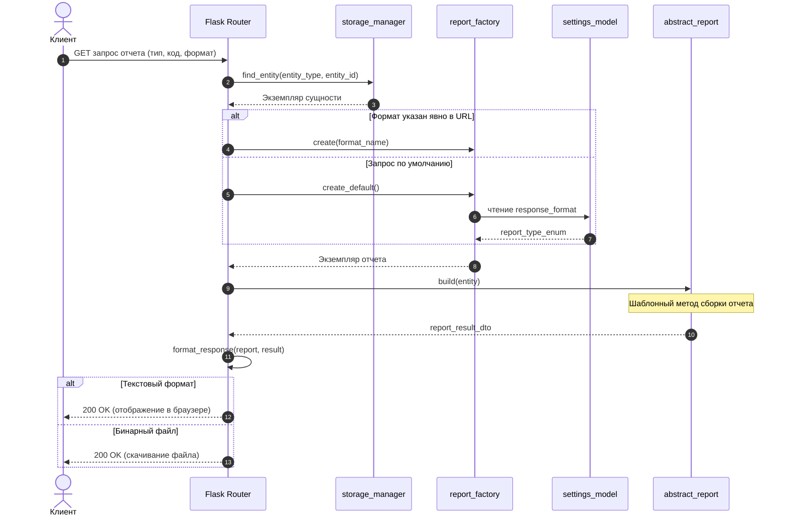

# Подсистема отчетов (ReportFactory)

## 1. Диаграмма классов

---

## 2. Диаграмма последовательности (REST API)

---

## 3. Таблица форматов

| Формат | Класс отчета | Тип данных | Content-Type | Поведение |
|---|---|---|---|---|
| **HTML** | `html_report` | Текст | `text/html; charset=utf-8` | Отображение таблицы на странице |
| **XML** | `xml_report` | Текст | `application/xml; charset=utf-8` | Дерево тегов XML |
| **TXT** | `text_report` | Текст | `text/plain; charset=utf-8` | Простой текст |
| **CSV** | `csv_report` | Бинарный | `text/csv` | Скачивание файла с разделителем `;` |
| **Markdown**| `markdown_report` | Бинарный | `text/markdown` | Скачивание файла `.md` |
| **RTF** | `rtf_report` | Бинарный | `application/rtf` | Скачивание файла `.rtf` |
