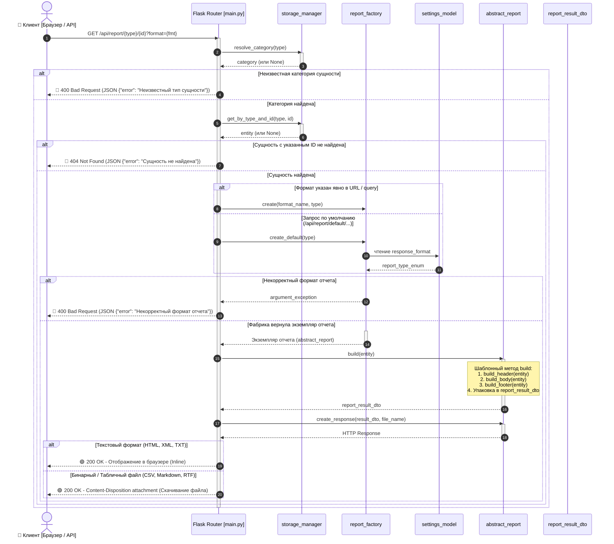

# Архитектура подсистемы отчетов (Abstract Factory & Template Method)

Подсистема отчетов предназначена для универсальной выгрузки данных доменных сущностей (`recipe_model`, `nomenclature_model`, `range_model` и др.) в различных форматах представления данных в соответствии с принципами **SOLID** и шаблонами GoF (**Abstract Factory** и **Template Method**).

---

## 1. Диаграмма классов (UML Class Diagram)

---

## 2. Диаграмма последовательности (UML Sequence Diagram: REST API)

Показывает жизненный цикл выполнения запроса к HTTP эндпоинту отчета с полной обработкой успешных путей (**200 OK**) и ошибок (**400 Bad Request**, **404 Not Found**):

> Полная спецификация сценариев взаимодействия и матрицы кодов ответа доступна в отдельном документе: [Диаграммы последовательности (SequenceDiagrams.md)](./SequenceDiagrams.md).

---

## 3. Сводная таблица форматов отчетов

| Формат | Класс отчета | Тип данных | Content-Type | Поведение в браузере |
|---|---|---|---|---|
| **HTML** | `html_report` | Текст | `text/html; charset=utf-8` | Отображение таблицы прямо на странице |
| **XML** | `xml_report` | Текст | `application/xml; charset=utf-8` | Отображение интерактивного дерева тегов XML |
| **TXT** | `text_report` | Текст | `text/plain; charset=utf-8` | Отображение неформатированного текста |
| **CSV** | `csv_report` | Бинарный | `text/csv` | Скачивание файла с разделителем `;` (Excel) |
| **Markdown**| `markdown_report` | Бинарный | `text/markdown` | Скачивание файла `.md` с табличной разметкой |
| **RTF** | `rtf_report` | Бинарный | `application/rtf` | Скачивание файла `.rtf` (WordPad, MS Word) |
