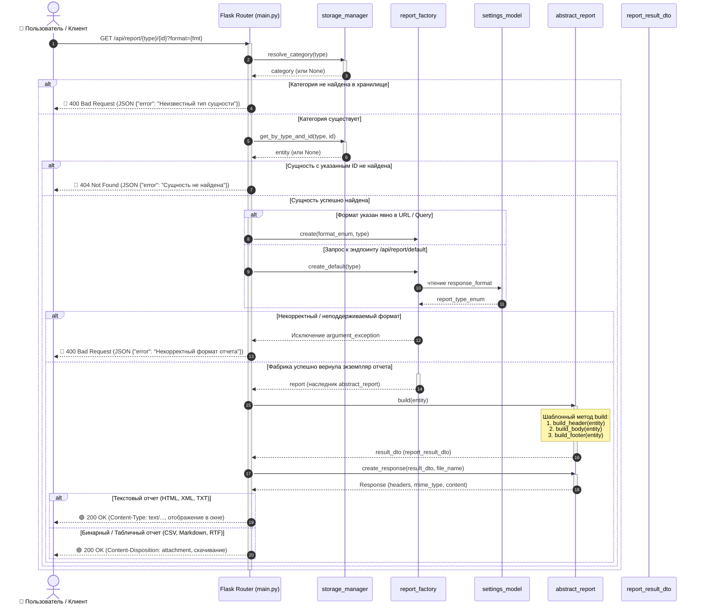
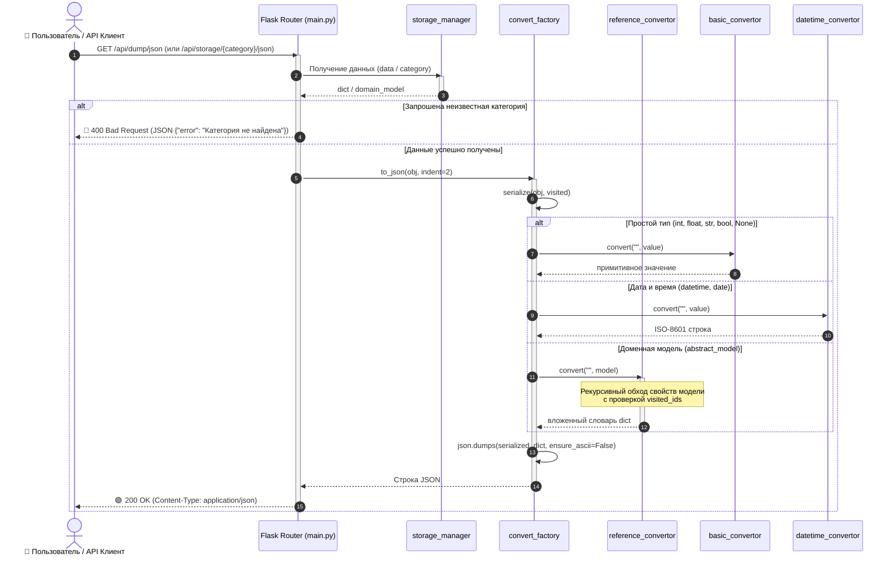
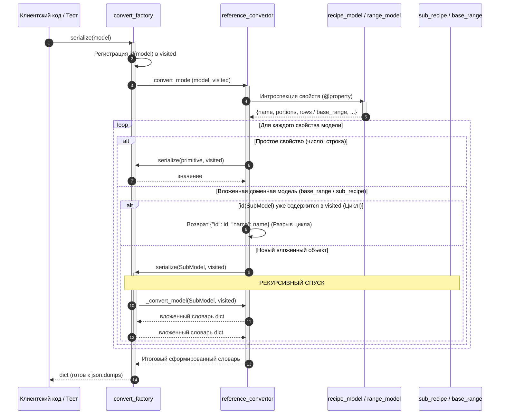

# Диаграммы последовательности (UML Sequence Diagrams)

Данный документ содержит исчерпывающие диаграммы взаимодействия компонентов системы во времени (**UML Sequence Diagrams**) с участием акторов (**Actor / Пользователь**), демонстрирующие как успешные пути исполнения (**Happy Path: 200 OK**), так и обработку исключительных ситуаций (**Error Handling: 400 Bad Request, 404 Not Found**).

---

## 1. Жизненный цикл запроса отчета (REST API Report Generation)

Диаграмма иллюстрирует взаимодействие компонентов при обработке маршрутов `/api/report/<entity>/<id>` и `/api/report/default/<entity>/<id>`.

---

## 2. Жизненный цикл сериализации в JSON (REST API JSON Dump)

Диаграмма иллюстрирует процесс выгрузки данных хранилища или отдельной модели в структурированный JSON через фабрику сериализации `convert_factory`.

---

## 3. Рекурсивный процесс сериализации модели (Deep Dive Sequence)

Диаграмма показывает внутреннюю механику рекурсивного спуска фабрики `convert_factory` и конвертера `reference_convertor` для сложных моделей (рецепты с полуфабрикатами и единицы измерения с цепочкой базовых мер):

---

## 4. Сводная матрица HTTP-статусов API

| HTTP Статус | Название | Причина возврата | Формат ответа |
| :--- | :--- | :--- | :--- |
| **`200 OK`** | Успех (текстовый) | Отчет в формате HTML, XML или TXT сформирован корректно | `text/html`, `application/xml`, `text/plain` |
| **`200 OK`** | Успех (скачивание) | Отчет в формате CSV, Markdown или RTF сформирован корректно | Файл во вложении (`Content-Disposition: attachment`) |
| **`200 OK`** | Успех (JSON) | Сериализация хранилища или сущности выполнена успешно | `application/json; charset=utf-8` |
| **`400 Bad Request`** | Ошибка клиента | Неизвестный тип сущности (`category`), либо недопустимый формат отчета | JSON: `{"error": "Описание ошибки"}` |
| **`404 Not Found`** | Не найдено | Сущность с указанным кодом/идентификатором отсутствует в хранилище | JSON: `{"error": "Сущность ... не найдена"}` |
| **`500 Internal Error`** | Ошибка сервера | Необработанное исключение при построении отчета или сериализации | JSON: `{"error": "Внутренняя ошибка сервера"}` |
