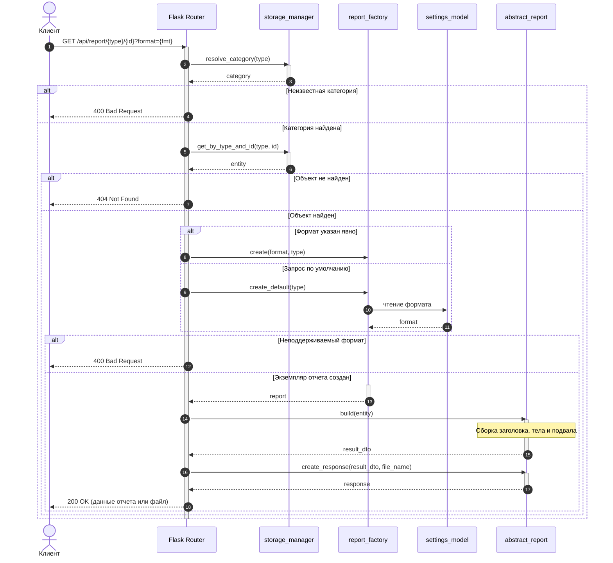
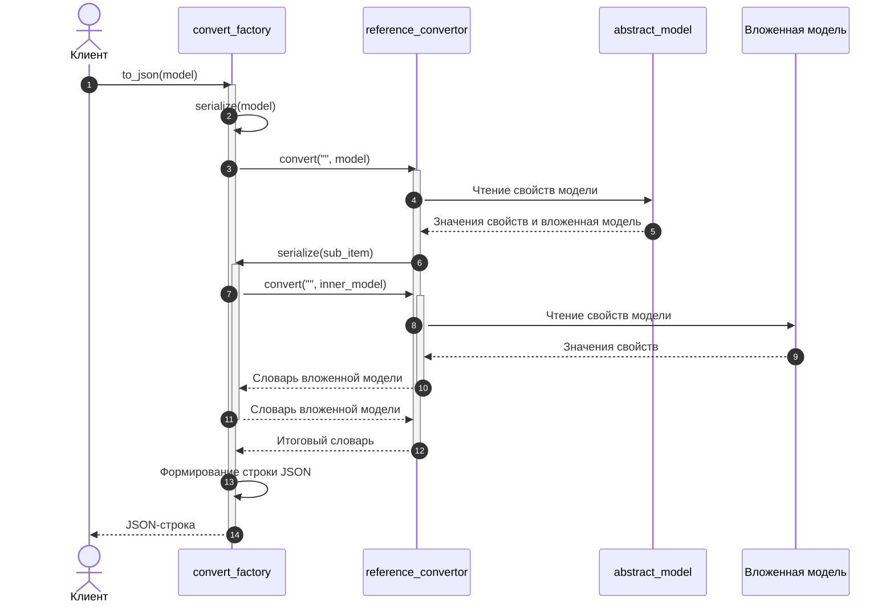

# Диаграммы последовательности (SequenceDiagrams)

## 1. Запрос отчета через REST API

Жизненный цикл запроса к эндпоинту отчета (`GET /api/report/{type}/{id}?format={fmt}`):

---

## 2. Сериализация составной модели в JSON

Схема работы `convert_factory` и `reference_convertor` при обходе объекта с вложенной моделью:

