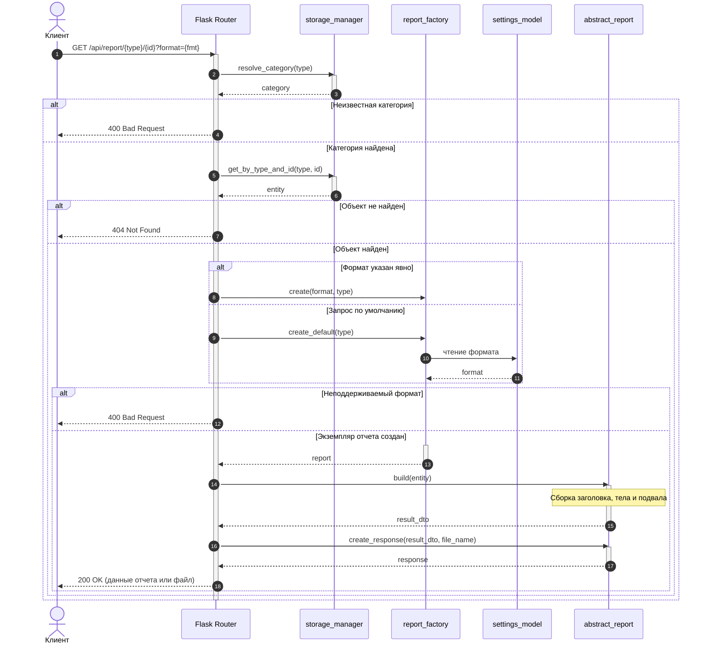
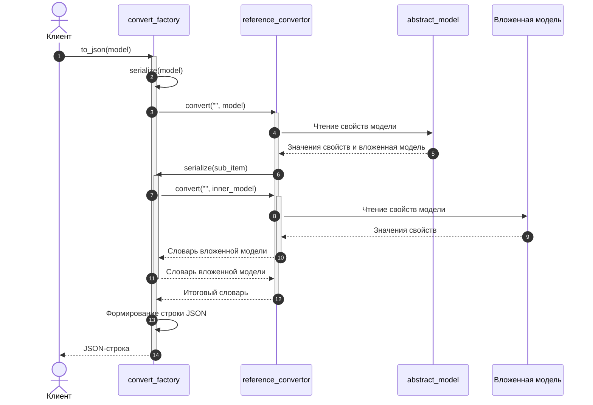
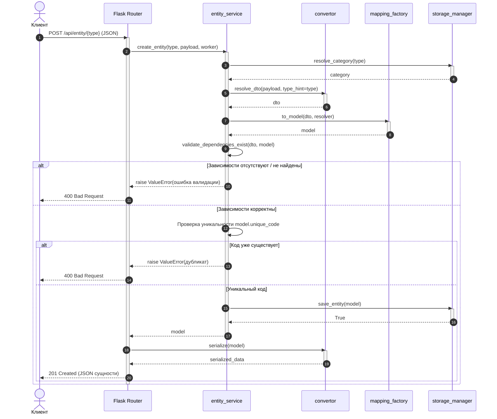
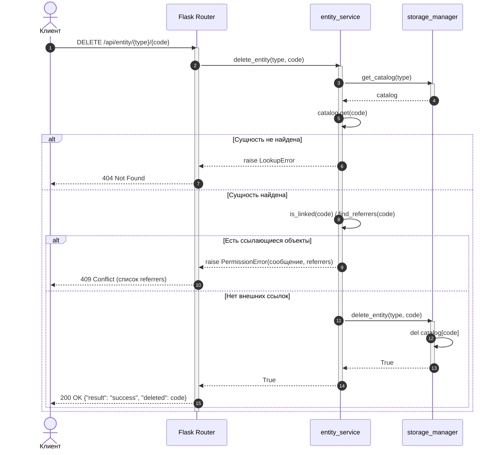

# Диаграммы последовательности (SequenceDiagrams)

## 1. Запрос отчета через REST API

Жизненный цикл запроса к эндпоинту отчета (`GET /api/report/{type}/{id}?format={fmt}`):

---

## 2. Сериализация составной модели в JSON

Схема работы `convert_factory` и `reference_convertor` при обходе объекта с вложенной моделью:

---

## 3. Управление сущностями через REST API и entity_service

### 3.1. Создание сущности (`POST /api/entity/{type}`)

### 3.2. Удаление сущности с защитой ссылочной целостности (`DELETE /api/entity/{type}/{code}`)

