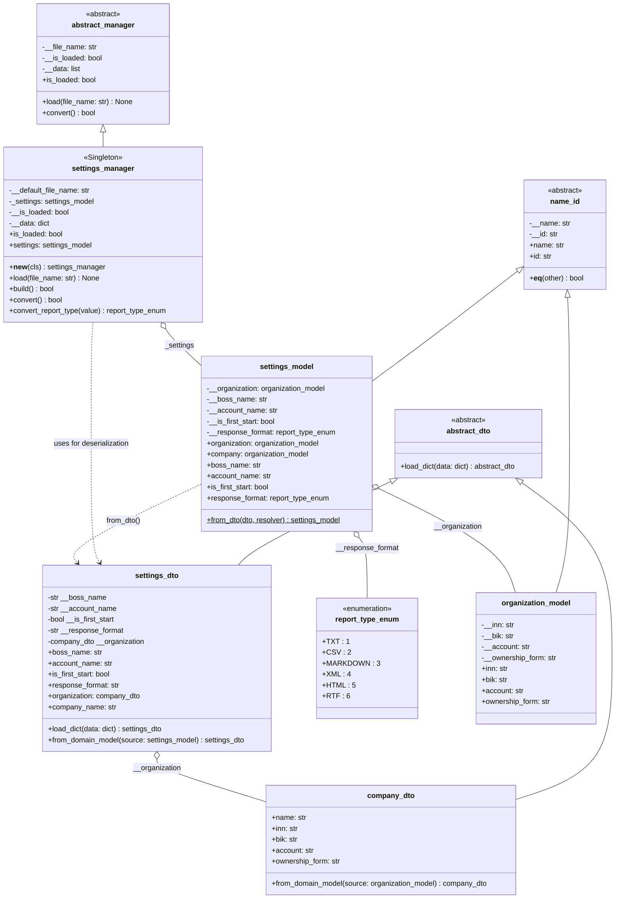

# Менеджер настроек (settings_manager)

## 1. UML-диаграмма классов

---

## 2. Механизм десериализации настроек

Загрузка файла `settings.json` выполняется через универсальный конвейер DTO и конвертера:

1. **Чтение JSON:** `settings_manager.load()` считывает файл конфигурации в словарь `__data`.
2. **Преобразование в DTO:** `convertor().deserialize(data)` идентифицирует поля настроек и заполняет `settings_dto` (а также вложенный `company_dto` для карточки организации).
3. **Отображение в модель:** `mapping_factory` вызывает фабричный метод `settings_model.from_dto(dto)`, создавая валидированный экземпляр доменной модели `settings_model`.
4. Поддерживается как структурированный формат (с объектом `organization`), так и плоский формат (с полем `company_name`).
