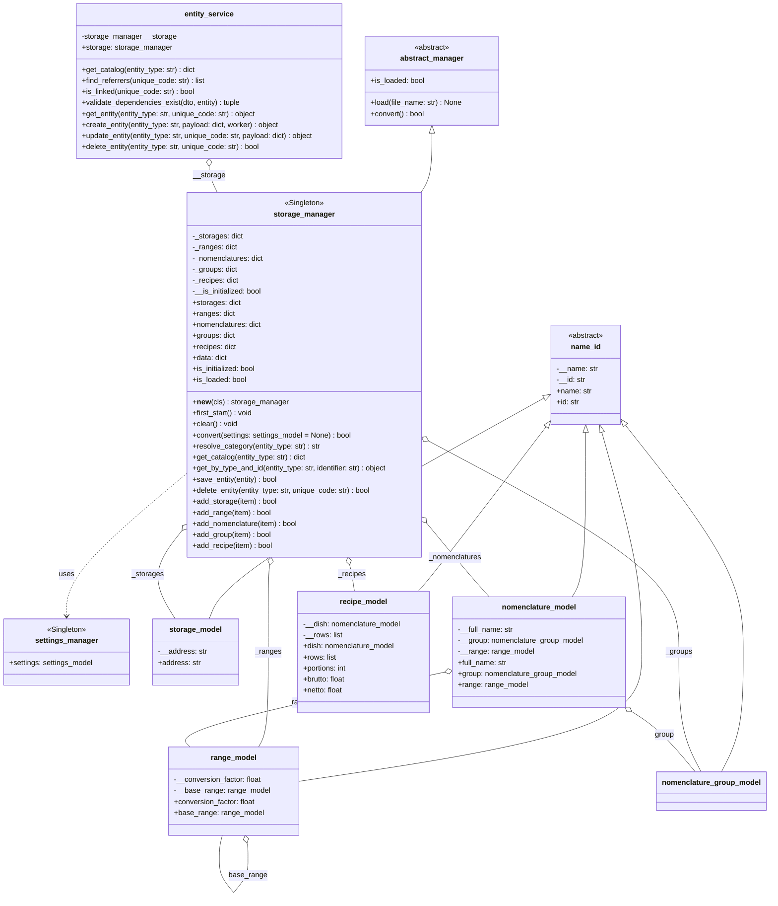

# Хранилище данных и сервис сущностей (storage_manager & entity_service)

## 1. UML-диаграмма классов

---

## 2. Разделение ответственности

* **`storage_manager`** — низкоуровневое хранилище данных (паттерн *Singleton*):
  * Хранение коллекций доменных объектов в оперативной памяти (`_storages`, `_ranges`, `_nomenclatures`, `_groups`, `_recipes`).
  * Индексация и разрешение категорий сущностей по строковым ключам (`resolve_category`, `get_catalog`).
  * Первичная инициализация справочников (`first_start()`, `_initialize_primary_data()`).
  * Базовые операции добавления (`add_*`, `save_entity`) и удаления по ключу (`delete_entity`).

* **`entity_service`** — сервисный слой для бизнес-логики работы с сущностями:
  * Полный цикл CRUD-операций (`get_entity`, `create_entity`, `update_entity`, `delete_entity`).
  * Проверка уникальности кодов сущностей перед сохранением.
  * Валидация наличия зависимых объектов (`validate_dependencies_exist`) при трансформации DTO в модель.
  * Контроль ссылочной целостности (`find_referrers`, `is_linked`): запрет удаления или модификации уникального кода сущностей, на которые ссылаются другие объекты (`PermissionError`).
