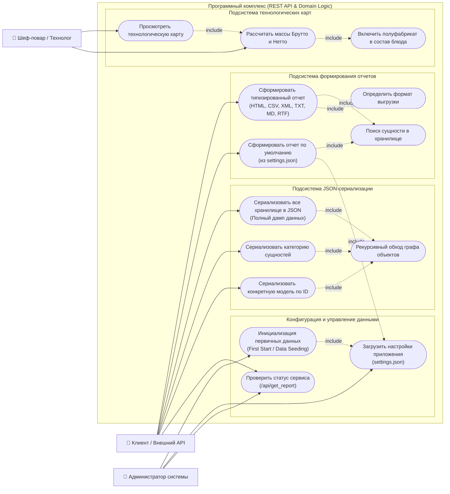

# Диаграмма прецедентов (UML Use Case Diagram)

Данный документ описывает функциональные роли (Акторов) и сценарии использования программного комплекса автоматизации сети ресторанов «ООО Ромашка» в соответствии с требованиями [технического задания](./Technicaltask.md) и принципами чистой архитектуры.

---

## 1. Диаграмма вариантов использования (UML Use Case)

---

## 2. Описание действующих лиц (Акторов)

| Актор | Назначение и зона ответственности |
| :--- | :--- |
| **`👤 Клиент / Внешний API`** | Внешние клиенты (мобильное приложение, веб-витрина, учетные микросервисы). Запрашивает аналитические отчеты в требуемых форматах (`HTML`, `CSV`, `Markdown`, `XML`, `TXT`, `RTF`), получает структурированные дампы хранилища в формате `JSON`. |
| **`👤 Администратор системы`** | Технический специалист / DevOps. Отвечает за инициализацию хранилища (`storage_manager.first_start()`), конфигурирование параметров организации и формата ответов по умолчанию через `settings.json`. |
| **`👤 Шеф-повар / Технолог`** | Пользователь производственного цеха и ресторанов. Составляет технологические карты блюд, включает полуфабрикаты (составные рецепты) и контролирует расчет расхода сырья (массы Нетто и Брутто). |

---

## 3. Спецификация ключевых прецедентов

### 3.1. Сформировать типизированный отчет
* **Эндпоинт:** `GET /api/report/{type}/{id}?format={fmt}`
* **Предусловие:** Хранилище инициализировано, запрошенный тип сущности зарегистрирован в системе.
* **Основной сценарий:**
  1. Клиент передает категорию сущности, идентификатор и желаемый формат.
  2. Система ищет объект в `storage_manager`.
  3. `report_factory` инстанциирует соответствующий класс отчета (например, `csv_report` или `html_report`).
  4. Метод `build()` собирает DTO отчета по шаблону (**Template Method**).
  5. Клиент получает текстовый ответ в браузере (`200 OK`) либо скачиваемый файл во вложении (`200 OK`).
* **Исключительные ситуации:**
  * Категория не найдена $\rightarrow$ `400 Bad Request`.
  * Объект не найден $\rightarrow$ `404 Not Found`.
  * Некорректный формат $\rightarrow$ `400 Bad Request`.

### 3.2. Сериализовать базу данных в JSON (Дамп хранилища)
* **Эндпоинт:** `GET /api/dump/json` / программный вызов `convert_factory.to_json(storage.data)`
* **Основной сценарий:**
  1. `convert_factory` принимает словарь данных `storage_manager.data`.
  2. Фабрика полиморфно подбирает конвертер (`basic_convertor`, `datetime_convertor`, `reference_convertor`) для каждого элемента.
  3. Для доменных моделей рекурсивно извлекаются свойства (`@property`), спускаясь по графу вложенных единиц измерения и рецептов.
  4. Формируется валидная строка JSON с кодировкой UTF-8 и отступами.

### 3.3. Расчет масс Брутто и Нетто составного рецепта
* **Основной сценарий:**
  1. Пользователь обращается к свойствам `recipe.netto` или `recipe.brutto`.
  2. Рецепт суммирует значения строк `rows`.
  3. Если в строке содержится полуфабрикат (`sub_recipe`), рецепт рекурсивно опрашивает массу вложенной технологической карты.
  4. Возвращается итоговый расчетный вес на 1 порцию.
