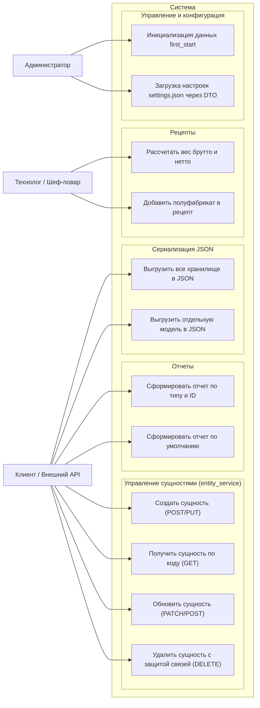

# Варианты использования (UseCase)

## 1. Диаграмма прецедентов

---

## 2. Описание ролей

* **Клиент / Внешний API:** запрашивает аналитические отчеты в нужных форматах (HTML, CSV, XML, TXT, MD, RTF), получает дампы сущностей в JSON, а также выполняет операции создания, чтения, модификации и удаления доменных сущностей через REST API и `entity_service`.
* **Технолог / Шеф-повар:** настраивает технологические карты, включает полуфабрикаты (составные рецепты) и контролирует расчет веса брутто и нетто.
* **Администратор:** отвечает за первичный запуск системы (`first_start()`) и управление файлом конфигурации `settings.json` через DTO-десериализацию.
