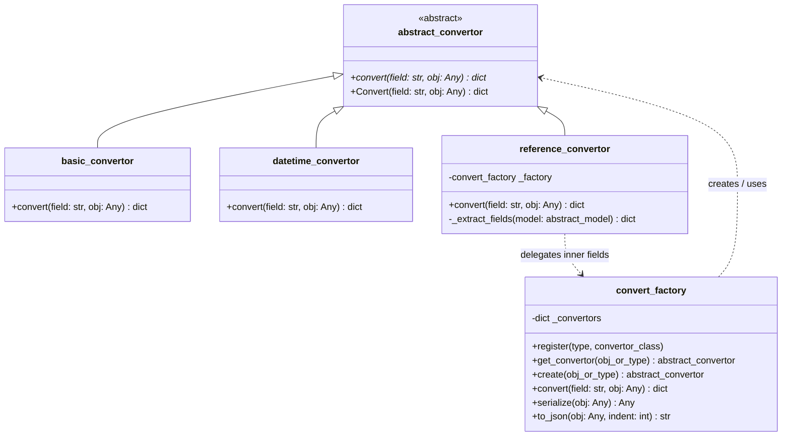

# Техническое задание и план реализации: Сериализация доменных моделей в JSON

Данный документ содержит исчерпывающее техническое задание, архитектурные диаграммы и пошаговый план для поэтапной реализации задания по сериализации доменных моделей в формат JSON.

---

## 1. Исходные данные и контекст

1. **Техническое задание:**
   - **Тема работы:** Сериализация Json
   - **Текст ТЗ:**
     > 1. Создать абстрактный класс `abstract_covertor`. В нем создать абстрактный метод `Convert`. Данный метод должен возвращать словарь в формате ключ - наименование поля, значение - данные поля. На вход данный метод должен получить любой объект.  
     > 1.1 Создать реализацию от абстрактного класса для формирования словаря по простым типам: numeric, str — `basic_convertor`.  
     > 1.2 Создать реализацию от абстрактного класса для формирования словаря по типу DateTime — `datetime_convertor`.  
     > 1.3 Создать реализацию от абстрактного класса для формирования словаря по типу Reference — `reference_convertor`.  
     > 2. Создать набор модульных тестов, которые проверяют конвертацию простых и составных типов.  
     > 3. Создать класс `convert_factory` по шаблону «Фабрика». Данный класс должен принимать любой объект любого типа и формировать набор словарей согласно исходной структуры, используя `basic_convertor`, `datetime_convertor`, `reference_convertor`.  
     > 4. Написать модульный тест для проверки работы `convert_factory`.

2. **Архитектурные требования:**
   - **Своя ООП-библиотека:** никаких готовых сторонних библиотек сериализации (Pydantic, Marshmallow и т.д.).
   - **Пайплайн в JSON:** Доменная модель $\rightarrow$ Вложенные словари Python (`dict`/`list`) $\rightarrow$ Стандартный `json.dumps()`.
   - **Рекурсивная сериализация:** 
     - Единицы измерения (`range_model`): содержат поле `base_range`, которое также является `range_model` и может иметь свой `base_range` (тонны $\rightarrow$ килограммы $\rightarrow$ граммы).
     - Рецепты (`recipe_model`): строки рецепта могут содержать вложенный `sub_recipe` (рецепт внутри рецепта / полуфабрикат).
   - **Фабрика вместо процедурного ветвления:**
     - Не писать километровые `if-elif-else` на проверку каждого типа.
     - Использовать реестр типов `dict[Type, Convertor]` по аналогии с подсистемой отчетов (`report_factory`).
   - **Сериализация данных хранилища:** возможность сериализовать сущности из `storage_manager.data`.

3. **Концептуальная схема сериализации:**
   - **Разбор схемы:**
     - В центре: `Domain` $\rightarrow$ `JSON`.
     - Пример `Группа`: поля `[код, наименование]` $\rightarrow$ `(Dict)` $\rightarrow$ `json.dump`.
     - Слева: Блок `Фабрика`:
       - `str` / простые типы $\rightarrow$ элемент словаря `Dict`.
       - `list` $\rightarrow$ список `[]`.
       - `abst_mod` (`abstract_model`) $\rightarrow$ вложенный `Dict`.
       - Стрелка **`рекур` (рекурсия)**:
         - `ЕД. ИЗ` (`Dict`) $\rightarrow$ поле `BASE` (`Dict`) $\rightarrow$ поле `BASE` (`Dict`).
     - Справа: Ссылка на паттерн отчетов `dict[Type, ...]` для маппинга типов без жестких `if`.

---

## 2. Архитектура решения

### 2.1 Диаграмма классов (Mermaid)

### 2.2 Спецификация контрактов и компонентов

#### 1. `abstract_convertor` (`Src/Core/abstract_convertor.py`)
- Наследуется от `abc.ABC`.
- Метод `convert(self, field: str, obj: Any) -> dict`:
  - Абстрактный метод.
  - Если `field` не пустой: возвращает `{field: converted_value}`.
  - Если `field` пустой / не передан: возвращает сконвертированное значение или словарь свойств.
- Метод `Convert`: алиас на `convert` для строгой совместимости с текстом ТЗ.
- Экспорт алиаса `abstract_covertor = abstract_convertor` (на случай опечатки в автоматических тестах).

#### 2. `basic_convertor` (`Src/Logics/basic_convertor.py`)
- Наследуется от `abstract_convertor`.
- Обрабатывает примитивные типы: `int`, `float`, `str`, `bool`, `type(None)`.
- Если передан неподдерживаемый тип, выбрасывает `argument_exception`.
- Возвращает `{field: obj}` (если `field` задан) или `{"value": obj}` / `obj`.

#### 3. `datetime_convertor` (`Src/Logics/datetime_convertor.py`)
- Наследуется от `abstract_convertor`.
- Обрабатывает типы `datetime.datetime` и `datetime.date`.
- Преобразует дату в строковый формат ISO 8601 (`obj.isoformat()`).
- Возвращает `{field: iso_str}` (если `field` задан) или `{"value": iso_str}`.

#### 4. `reference_convertor` (`Src/Logics/reference_convertor.py`)
- Наследуется от `abstract_convertor`.
- Обрабатывает сущности, наследующие `abstract_model` (`name_id`), а также объекты предметной области.
- Извлекает свойства объекта:
  - Стандартные: `id` (или `unique_code`), `name`.
  - Специфичные свойства моделей: `conversion_factor`, `base_range`, `group`, `range`, `full_name`, `dish`, `cooking_time`, `instructions`, `portions`, `rows`, `nomenclature`, `brutto`, `netto`, `range_unit`, `sub_recipe`, `address`, `inn`, `bic`, `account`, `type_ownership`.
- Рекурсивно обрабатывает вложенные свойства через `convert_factory.serialize(...)`.
- Включает механизм защиты от циклических ссылок (`visited_ids: set`).
- Возвращает `{field: model_dict}` или `model_dict`.

#### 5. `convert_factory` (`Src/Logics/convert_factory.py`)
- Реализация паттерна «Фабрика» (Factory).
- Инкапсулирует реестр конвертеров `_convertors: dict[type, type[abstract_convertor]]`.
- Поддерживает регистрацию новых типов через `register(target_type, convertor_cls)`.
- Метод `get_convertor(obj_or_type)`: полиморфный подбор конвертера с учетом наследования (`issubclass` / `isinstance`).
- Метод `serialize(obj: Any) -> Any`: универсальный рекурсивный метод сериализации:
  - Для примитивов $\rightarrow$ базовое значение;
  - Для дат $\rightarrow$ ISO-строка;
  - Для доменных моделей $\rightarrow$ словарь полей через `reference_convertor`;
  - Для коллекций (`list`, `tuple`, `set`) $\rightarrow$ список сериализованных элементов;
  - Для словарей (`dict`) $\rightarrow$ словарь с сериализованными значениями (поддержка `storage_manager.data`).
- Метод `to_json(obj: Any, indent: int = 2) -> str`:
  - Вызывает `serialize(obj)`.
  - Формирует строку JSON через `json.dumps(serialized_data, ensure_ascii=False, indent=indent)`.

---

## 3. Пошаговый план выполнения (Чек-лист для агента)

Агент должен строго последовательно выполнять следующие шаги, проверяя работоспособность тестами после каждого этапа.

### Этап 1: Создание базового контракта `abstract_convertor`
* [ ] Создать файл `Src/Core/abstract_convertor.py`.
* [ ] Определить абстрактный класс `abstract_convertor(ABC)`.
* [ ] Реализовать абстрактный метод `convert(self, field: str, obj: Any) -> dict`.
* [ ] Добавить алиасы `Convert = convert` и `abstract_covertor = abstract_convertor`.
* [ ] Добавить валидацию входных параметров через `validator` / `argument_exception`.

### Этап 2: Реализация `basic_convertor`
* [ ] Создать файл `Src/Logics/basic_convertor.py`.
* [ ] Реализовать класс `basic_convertor(abstract_convertor)`.
* [ ] Реализовать логику для `int`, `float`, `str`, `bool`, `None`.
* [ ] Обработать корректное формирование словаря `{field: obj}`.
* [ ] Реализовать проверку недопустимых типов с выбросом `argument_exception`.

### Этап 3: Реализация `datetime_convertor`
* [ ] Создать файл `Src/Logics/datetime_convertor.py`.
* [ ] Реализовать класс `datetime_convertor(abstract_convertor)`.
* [ ] Реализовать приведение `datetime` и `date` к формату ISO 8601 (`obj.isoformat()`).
* [ ] Реализовать формирование словаря `{field: formatted_date}`.
* [ ] Реализовать валидацию типа входного объекта.

### Этап 4: Реализация `reference_convertor`
* [ ] Создать файл `Src/Logics/reference_convertor.py`.
* [ ] Реализовать класс `reference_convertor(abstract_convertor)`.
* [ ] Реализовать извлечение атрибутов/свойств моделей `abstract_model`.
* [ ] Реализовать рекурсивную обработку вложенных моделей (`base_range`, `sub_recipe`, `group`, `range`) через делегирование фабрике.
* [ ] Реализовать защиту от циклических зависимостей.

### Этап 5: Реализация `convert_factory`
* [ ] Создать файл `Src/Logics/convert_factory.py`.
* [ ] Реализовать класс `convert_factory`.
* [ ] Заполнить маппинг типов по умолчанию:
  - `int`, `float`, `str`, `bool` $\rightarrow$ `basic_convertor`
  - `datetime`, `date` $\rightarrow$ `datetime_convertor`
  - `abstract_model` $\rightarrow$ `reference_convertor`
* [ ] Реализовать метод `register(type, convertor_cls)` для принципа Open-Closed.
* [ ] Реализовать метод `get_convertor(obj_or_type)` / `create(obj_or_type)`.
* [ ] Реализовать метод `serialize(obj)` для универсальной рекурсивной сериализации (модели, списки, словари, примитивы).
* [ ] Реализовать метод `to_json(obj, indent=2)` с использованием `json.dumps(..., ensure_ascii=False)`.

### Этап 6: Написание полного набора модульных тестов
* [ ] Создать `Tst/test_convertors.py`:
  - Тесты `abstract_convertor` (невозможность прямой инстанциации, проверка контракта).
  - Тесты `basic_convertor` (числа, строки, булевы значения, None, валидация ошибок при некорректных типах).
  - Тесты `datetime_convertor` (объекты `datetime`, `date`, корректность ISO строки, ошибки при некорректных типах).
  - Тесты `reference_convertor` (простые сущности `group`, `storage`, вложенные единицы измерения `range_model` с `base_range`, номенклатура со ссылками).
* [ ] Создать `Tst/test_convert_factory.py`:
  - Тесты метода разрешения фабрики `get_convertor` / `create`.
  - Тесты сериализации отдельных моделей и списков моделей.
  - Тесты глубокой рекурсии: цепочка единиц измерения `тонна -> кг -> грамм`.
  - Тесты глубокой рекурсии: рецепт со строками и вложенным `sub_recipe` (полуфабрикат).
  - Тесты сериализации хранилища: `storage_manager().data` целиком.
  - Тест валидности JSON: проверка десериализации через `json.loads(factory.to_json(...))`.
* [ ] Запустить полный тестовый набор `./venv/bin/pytest` и убедиться, что все тесты (142 существующих + новые) успешно проходят (100% PASS).

### Этап 7: Документирование архитектуры
* [ ] Создать файл `Docs/JsonSerialization.md`.
* [ ] Описать назначение модуля, архитектуру, примененные паттерны (Factory, Template Method).
* [ ] Добавить примеры использования: как сериализовать модель, как сериализовать `storage_manager`, как выгрузить в файл.

---

## 4. Критерии приемки (Definition of Done)

1. Все 142 существующих теста проекта проходят без единой ошибки.
2. Новые тесты полностью покрывают `abstract_convertor`, `basic_convertor`, `datetime_convertor`, `reference_convertor` и `convert_factory`.
3. Нет циклических импортов и процедурных спагетти-условий `if isinstance(...)`.
4. В коде отсутствуют сторонние библиотеки сериализации (Pydantic и др.) — только стандартный `json` Python и написанные конвертеры.
5. Рекурсивные структуры (`base_range`, `sub_recipe`) успешно разворачиваются во вложенные словари.
6. Вызов `factory.to_json(storage_manager().data)` формирует валидный JSON без ошибок сериализации.
